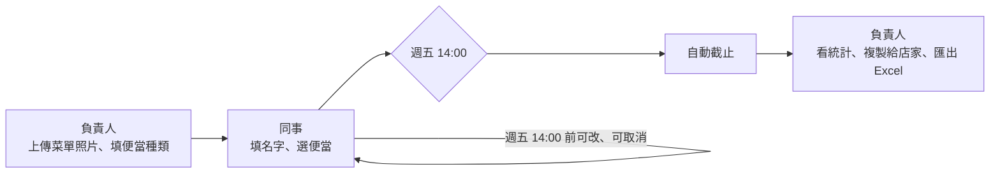

# 甲奔！dinbendon

公司內部訂便當。負責人每週放上菜單照片和便當種類，大家填名字選便當，週五 14:00 自動截止，負責人在後台看統計、匯出 Excel。



## 架構

跟 eagle-tasks 同一套：**Vite + React + TS 靜態站 → Google Apps Script Web App 當 API → Google Sheet 當資料庫**。菜單圖片存在 Google Drive。

| 路徑 | 說明 |
| --- | --- |
| `#/` | 點餐頁：碗公動畫、菜單照片、選便當、倒數、已點名單 |
| `#/admin` | 負責人後台：菜單設定、訂單統計、匯出 Excel、複製給店家 |
| `apps-script/Code.gs` | 後端，貼到綁定試算表的 Apps Script |

截止時間一律以台北時間計算，前端擋、後端也擋（過了時間 `placeOrder` 會直接拒絕）。

## 本機開發（Demo 模式）

```bash
npm install
npm run dev
```

沒設定 `VITE_GAS_URL` 時是 **Demo 模式**：資料存在瀏覽器 localStorage，附一份假菜單和幾筆訂單，負責人密碼是 `admin`。想重來就在 DevTools 刪掉 `dinbendon:demo:v1`。

## 接上 Google Sheet

1. 開一個新的 Google 試算表（例如「甲奔訂便當」）。
2. 擴充功能 → Apps Script，把 `apps-script/Code.gs` 貼進去；在「專案設定」勾選顯示 `appsscript.json`，用本 repo 的內容覆蓋。
3. 專案設定 → 指令碼屬性，新增 `ADMIN_PASSWORD`（負責人密碼）。想指定圖片資料夾就再加 `IMAGE_FOLDER_ID`。
4. 在編輯器選 `setup` 執行一次，照指示授權。會建立 `weeks`、`orders` 兩張表和「dinbendon 菜單」資料夾。
5. 部署 → 新增部署作業 → 網頁應用程式：執行身分「我」、存取權「所有人」。複製 `.../exec` 網址。
6. 專案根目錄建立 `.env.local`：

   ```
   VITE_GAS_URL=https://script.google.com/macros/s/xxxx/exec
   ```

之後改了 `Code.gs` 要「管理部署作業 → 編輯 → 新版本」，網址才會吃到新程式。

### 公司 Workspace 的兩個坑

- **存取權選不到「所有人」**：網域管理員可能限制成只能「eagleai.tw 內的使用者」。這樣瀏覽器 fetch 會被導到登入頁而失敗，需要請管理員開放，或改用個人 Google 帳號部署。
- **菜單圖片看不到**：若 Workspace 禁止對外分享，後端會改用「網域內有連結即可看」，同事需要在瀏覽器登入公司 Google 帳號才看得到圖。

## 部署到 GitLab Pages

已附 `.gitlab-ci.yml`。到 Settings → CI/CD → Variables 加上 `VITE_GAS_URL`，推到預設分支就會建置到 Pages。build 預設用相對路徑（`./`），放在子路徑底下也能跑；要指定可設 `BASE_PATH=/dinbendon/`。

## Excel 匯出內容

檔名 `甲奔_便當訂單_2026-10-23.xlsx`，兩張工作表：

- **統計**：每種便當的單價、數量、小計、誰點的，最後一列合計。
- **訂單明細**：姓名、便當、單價、數量、小計、備註、下單時間，留一欄「已付款」給負責人收錢時打勾。

後台另有「複製給店家」，會把「排骨便當 × 5」這種文字複製起來，直接貼 LINE 給店家。

## 規則

- 一個名字一週一筆訂單（不分大小寫）。用同一個名字再送一次 = 修改；要幫別人點就填對方的名字。
- 截止前自己可以修改、取消；截止後只有負責人能在後台刪除。
- 開新的一週會沿用上週的店名和品項，只改不一樣的地方；舊的週次都留在統計頁的下拉選單裡。
