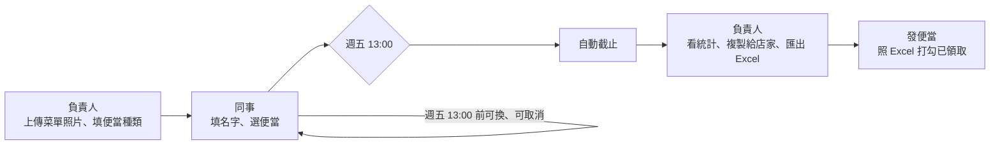

# 甲奔！dinbendon

公司每週請吃便當。負責人每週放上菜單照片和便當種類，大家填名字選一個便當，週五 13:00 自動截止，負責人在後台看統計、匯出 Excel。



## 架構

跟 eagle-tasks 同一套：**Vite + React + TS + Tailwind CSS v4 靜態站（pnpm）→ Google Apps Script Web App 當 API → Google Sheet 當資料庫**。菜單圖片存在 Google Drive。

| 路徑 | 說明                            |
| --- |-------------------------------|
| `#/` | 點餐頁：碗公動畫、菜單照片、選便當、倒數          |
| `#/admin` | 訂單管理：菜單設定、訂單統計、匯出 Excel、複製給店家 |
| `apps-script/Code.gs` | 後端，貼到綁定試算表的 Apps Script       |

截止時間一律以台北時間計算，前端擋、後端也擋（過了時間 `placeOrder` 會直接拒絕）。

## 本機開發（Demo 模式）

```bash
pnpm install
pnpm dev
```

沒設定 `VITE_GAS_URL` 時是 **Demo 模式**：資料存在瀏覽器 localStorage，附一份假菜單和幾筆訂單。想重來就在 DevTools 刪掉 `dinbendon:demo:v5`。

## 接上 Google Sheet

1. 開一個新的 Google 試算表（例如「甲奔訂便當」）。
2. 擴充功能 → Apps Script，把 `apps-script/Code.gs` 貼進去；在「專案設定」勾選顯示 `appsscript.json`，用本 repo 的內容覆蓋。
3. 訂單管理（`#/admin`）不用密碼，知道網址就能進。想指定圖片資料夾，到專案設定 → 指令碼屬性加 `IMAGE_FOLDER_ID`。
4. 在編輯器選 `setup` 執行一次，照指示授權。會建立 `weeks`、`orders` 兩張表和「dinbendon 菜單」資料夾。
5. 部署 → 新增部署作業 → 網頁應用程式：執行身分「我」、存取權「所有人」。複製 `.../exec` 網址。
6. 專案根目錄建立 `.env.local`：

   ```
   VITE_GAS_URL=https://script.google.com/macros/s/xxxx/exec
   ```

之後改了 `Code.gs` 要「管理部署作業 → 編輯 → 新版本」，網址才會吃到新程式。

### 公司 Workspace 的兩個坑

- **存取權選不到「所有人」**：網域管理員可能限制成只能「eagleai.tw 內的使用者」。這樣瀏覽器 fetch 會被導到登入頁而失敗，需要請管理員開放，或改用個人 Google 帳號部署。
- **菜單圖片看不到**：若 Workspace 禁止對外分享，後端會改用「網域內有連結即可看」，同事需要在瀏覽器登入公司 Google 帳號才看得到圖。

## 部署到 Vercel

GitHub repo 匯入 Vercel 即可，會自動偵測 Vite + pnpm（`pnpm build`，輸出 `dist`）。到 Project Settings → Environment Variables 加上 `VITE_GAS_URL`，改了變數要重新部署才會生效。用 hash 路由，不需要 rewrite 設定。

## 樣式

Tailwind CSS v4，設定都在 `src/styles.css`：`@theme` 是顏色（`yolk`、`soy`、`stamp`…）、字型、陰影等 token，`@layer components` 只放到處重複的 `btn`、`card`、`field`、`pill`、`page`，其他都直接寫 utility。碗公 SVG 的動畫依 mood 切換，維持一般 CSS。

## 飲料 Bonus（抖內／揪團）

後台「飲料 Bonus」填自己的名字、選**抖內**（我請大家喝）或**揪團**（各付各的），拉一下拉霸機抽今天喝哪家（只能用抽的，開團後不能換）、設截止時間（預設開團後 1 小時）、按「開團！」。收單中時點餐頁會從畫面中間彈出飲料卡片：選飲料、甜度、冰量、加料，一人一杯，一律 L，加料單選，飲料不設上限。揪團時「複製訂單」和 Excel 每人後面會帶要付的錢。統計、Excel、複製給店家都會帶甜度冰量加料。飲料店清單在 `src/shops.ts` 的 `DRINK_SHOPS`（15 家高雄的店），logo 在 `public/logos/`，logo 留空的店會用店名文字章代替。

## 喝飲料不揪／吃點心不揪

開飲料團、點心團時勾「喝飲料不揪」（點心團叫「吃點心不揪」），多設一組**通關密碼**（跟開團密碼分開，參加的人拿到也不能刪單、流團）。開好後畫面中間會秀專屬連結 `#/r/<團 id>` 和通關密碼，按「複製揪團資訊」整段貼給要揪的人。

- 點餐頁不會跳出來，也不佔「同時只能一團」的名額：公開的團收單中也能另開（「另開喝飲料不揪」）。
- 打開專屬連結要輸入通關密碼，對了會記在那台電腦，下次不用再輸入；下單、取消後端也會檢查。
- 訂單管理看得到這團存在（前面有小鎖頭，下拉寫【喝飲料不揪】／【吃點心不揪】），但要通關密碼才看得到訂單。

## 常用店家

`src/shops.ts` 列了常叫的店家（店名、菜單照片、便當和單價），照片放 `public/menus/`。後台「菜單設定 → 常用店家」選了就整份帶入，推上 GitHub 後 Vercel 自動重新部署。加一家：照片丟進 `public/menus/`、在 `SHOPS` 加一筆。照片檔名不要改，舊週次存的是那個路徑。

## Excel 匯出內容

檔名 `甲奔_便當訂單_2026-10-23.xlsx`，兩張工作表：

- **統計**：每種便當的單價、數量、小計、誰點的，最後一列合計人數和總金額（請款用）。
- **訂單明細**：姓名、便當、金額、下單時間，依便當排序，留一欄「已領取」給發便當時打勾。

後台另有「複製給店家」，會把「排骨便當 × 5」這種文字複製起來，直接貼 LINE 給店家。

## 規則

- 公司請客，**一人一個便當**，沒有數量和備註。金額照菜單單價算（統計頁、Excel 都有小計和總金額），負責人拿去請款。
- 一個名字一週一筆（不分大小寫）。用同一個名字再選一次 = 換便當。
- 截止前自己可以換、取消；截止後只有負責人能在後台刪除。
- 開新的一週會沿用上週的店名和品項，只改不一樣的地方；舊的週次都留在統計頁的下拉選單裡。
